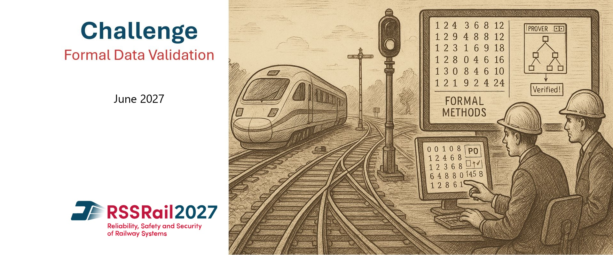
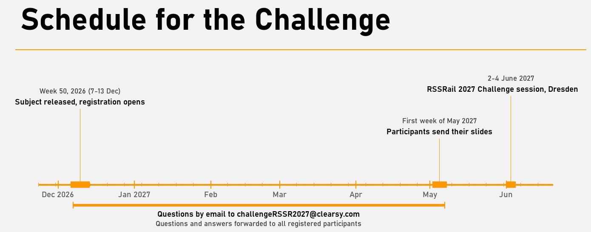

# FORMAL-DATA-VALIDATION-CHALLENGE-2027

The [RSSRail 2027 conference](https://rssrail2027.dzsf.de/WebS/RSSRail2027/EN/home_node.html) is organising a data validation challenge to promote the use of formal methods for validating constant data among CBTC and ERTMS industry companies, operators, and research teams. 
To participate do as follow:
1. Have a look at the content of this site and see if it fits your skills.
2. Register by sending an email to challengeRSSR2027@clearsy.com. Registration is informal but mandatory to participate.
3. Develop your solution. Ask your questions by email to challengeRSSR2027@clearsy.com. Questions are shared to anyone as well as the answers.
4. Send presentation slides by the first week of May 2027, to validate your participation to the Challenge session. Your presentation focuses on your own approach: the subject is presented once at the start of the session and is not repeated in each contribution.
5. Present your contribution on site in Dresden, 2-4 June 2027, during the Challenge session.

## What?
The goal? To identify **anomalies** in a database for a specified list of self-sufficient specifications. 
This database, especially designed for this event, will use the open format of the ERTMS system. 
It will include key elements such as telegrams, transponders, and LEUs. 
The tasks aim to verify the coherence of telegram formats, the rules of transponder positions, and the construction of movement authority packets within a realistic framework. 
Participation is free and open to all teams, from academia and from industry.

## How?
The challenge is designed to be completed in one week by a team of 2 to 3 people. 
The necessary resources (specification, data) will be accessible on this dedicated github repository from week 50 of 2026 (7-13 December) until the conference in June 2027, allowing participants to organize their resolution team. 
The data are provided in open formats for wide accessibility: the infrastructure and the interlocking in railML 3.3 (XML), the balise telegrams and the LEU programming in JSON. The specification, a guide and the track plan are provided as HTML pages. 
A support will be provided during this period to address any questions and resolve issues. 
Questions and answers will be shared with all participants to ensure a common understanding.

## When?
During the conference a dedicated 1h30 session will be organized: 10' for Baptiste Pézelier to present the subject, equal time for the participants to expose their models and results.
Since the subject is presented once, each presentation focuses on the participant's particular approach (formalism, tools, modelling choices, anomalies found) and does not repeat the subject.
It will enable participating teams to present their analyses and discuss the results. 
This will be the opportunity for newcomers to engage with the subject thanks to this hands-on experience. 

## Explanations
### What is Formal Data Validation?
Formal data validation in the railway industry refers to the use of formal methods (mathematically-based techniques) to systematically and rigorously verify the correctness of data used in safety-critical systems. 
It is especially crucial in railways, where incorrect configuration data (e.g., track topology, signal positions, speed limits) can lead to unsafe behavior, even if the software is correct.

###  What is "data" in this context?
In railway systems, large amounts of configuration data are used to adapt generic software to specific track layouts and operational scenarios. Examples include:
- Geometry and topology of the railway network
- Positions and parameters of signals and switches
- Speed profiles
- Balise group positions (for ERTMS)
- Route tables and interlocking rules

### What does "formal validation" do?
Formal data validation checks that all data used by the safety-critical software:
- Are correct (conform to rules and constraints)
- Are complete (nothing missing)
- Are consistent (no internal contradictions)
- Preserve safety properties (e.g., no two conflicting routes active at the same time)

### Typical techniques used
- Modeling of data constraints using formal specification languages (e.g., B, Event-B, Z, or custom domain-specific languages)
- Automated or semi-automated checking using tools
- Proofs or exhaustive checks that the data satisfy safety invariants

### Some scientific resources
- Lecomte, T., Almeida, D., Germain, V., Leuschel, M. (2026). Data validation based on a formal specification of the safety requirements - 20 years of industrial experience. In: Brazilian Symposium on Formal Methods, SBMF 2026. Lecture Notes in Computer Science. Springer. To appear.
- Butler, M. et al. (2020). The First Twenty-Five Years of Industrial Use of the B-Method. In: ter Beek, M.H., Ničković, D. (eds) Formal Methods for Industrial Critical Systems. FMICS 2020. Lecture Notes in Computer Science(), vol 12327. Springer.
- Abo, R., Voisin, L. (2014). Formal Implementation of Data Validation for Railway Safety-Related Systems with OVADO. In: Counsell, S., Núñez, M. (eds) Software Engineering and Formal Methods. SEFM 2013. Lecture Notes in Computer Science(), vol 8368. Springer.
- Bendisposto, J., Krings, S., Leuschel, M. (2014). Who watches the watchers: Validating the ProB Validation Tool. In: Electronic Proceedings in Theoretical Computer Science, vol 149.
- Lecomte, T., Burdy, L., Leuschel, M. (2012). Formally Checking Large Data Sets in the Railways. In: Proceedings of DS-Event-B 2012: Workshop on the experience of and advances in developing dependable systems in Event-B, ICFEM 2012. 
